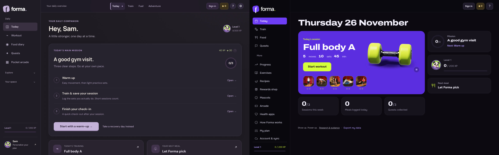
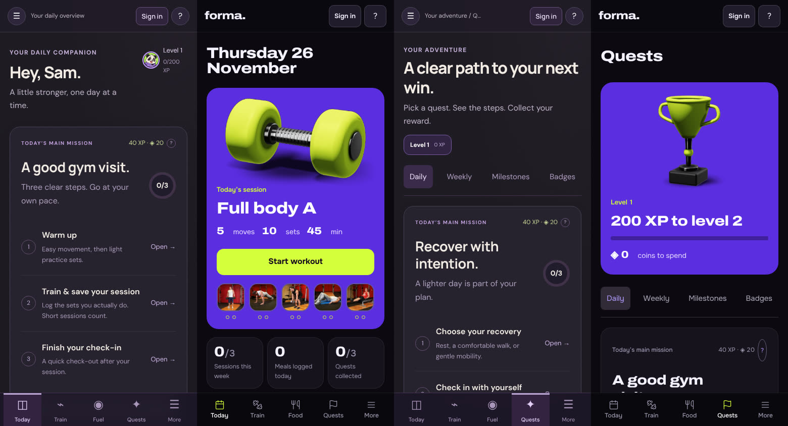

# Forma Gym Companion: Redesign

- **Original:** https://forma-gym-companion.greenant33.chatgpt.site
- **Live preview (private):** https://claude.ai/artifact/BPXaGq6yDrk4177yJ2hjHE
- **This copy:** `site/`. Open `site/index.html` through any static server (`python3 -m http.server -d site`).
- **Date:** 26 November 2026
- **Method:** the `unslop` skill's audit and nine passes, checked against [ux-laws.md](../../knowledge/ux-laws.md) and [anti-slop.md](../../knowledge/anti-slop.md).

## The one-line verdict

The app was already well built: a real brand, real exercise photos, a mascot people would like. It was buried under three navigation menus, ALL CAPS labels, text too small to read, and a Today screen that hid the workout below the fold.

## Measured before and after

Same 8 screens (Today, Train, Food, Progress, Quests, Recipes, Exercises, My plan), measured in Chromium on a 390px phone.

| Check | Before | After |
| --- | --- | --- |
| Text elements under 12px | 91 | 0 |
| "↗" external-link arrows on buttons that stay in the app | 53 | 0 |
| ALL CAPS labels | 11 | 0 |
| Tap targets under 44px | 118 | 22 |
| Navigation menus on desktop | 2 (sidebar + top bar), with different names | 1 |
| Names for the same place | Workout / Train, Food diary / Fuel, Quests / Adventure | Train, Food, Quests everywhere |
| Taps from Today to starting a workout | 2, after scrolling past the mission | 1, in the first screen |

Contrast of the bold palette: body text 16.6:1, secondary 10.2:1, muted 5.8:1 at worst, white on the violet button 5.8:1, dark text on the lime button 16.8:1, lime on the violet session card 6.2:1. All pass WCAG AA (4.5:1).

## Direction

- **Product:** a gym companion that gives beginners one prepared workout a day, a food diary, and a small game to keep them coming back.
- **Character:** patient, encouraging, a little playful.
- **World:** a home-gym corner at night. Rubber mats, a lamp, plants. It's the app's own illustration.
- **Moment:** today's session. Real exercise photos, sets and reps, one Start button.
- **Colour (v2, bold):** taken from Pip the panda. Electric violet (#6d3df5, his hoodie) for everything you press and the active place in the nav. Volt lime (#d4ff3a, his fur, and the app's own earlier accent) for progress you earn: set dots, the mission ring, XP, completed steps, and the one Start button. Near-black violet-tinted surfaces (#0c0a10) so both hit hard. Headlines in Manrope 800.
- **Signature:** set dots. One small lime ring per working set, wherever sets are listed (Today and Train).

## What changed, by pass

1. **Spacing.** One 4px rhythm in the new parts. Sidebar rows 40px with 2px between them (48px in the phone drawer). Section label "More" sits 8px above its items.
2. **Colour.** The purple-tinted greys became violet-tinted near-blacks (344 values) and the light purples became one electric violet (133 values). Today's session is a solid violet block with a lime Start button, the loudest thing on the screen. The radial colour wash and film grain behind the page are gone.
3. **Icons.** Unicode glyphs (◫ ⌁ ◉ ✦ ▦) became one line-icon set at 18px, 1.5 stroke, in the text colour.
4. **Copy.** ALL CAPS labels became sentence case. "↗" arrows removed from in-app buttons and kept only on real external links. Single-sentence headings lost their trailing period. Today's title is the date, not "Hey, Sam." The greeting moved into the subtitle with the day type ("Training day, Sam. Your session is ready.").
5. **Type.** Minimum 12px everywhere (221 sizes raised). Weights 800/900 became 600 (42). Wide tracking on small labels removed (25).
6. **Layout.** One navigation model: Today, Train, Food, Quests, then More (Progress, Exercises, Recipes, Rewards shop, Mascots, Arcade, Health apps, How Forma works, My plan, Account & sync). The same five names appear in the sidebar and the phone tab bar. The top-bar menu and the duplicate hamburger on phones are gone. Today now leads with the session. On rest days the recovery mission leads and the session becomes "Train anyway". The tour banner became one quiet line with a Dismiss.
7. **Details.** Cards, buttons and chips share one surface step and a hairline border. No glows. Exercise tags on photos got a solid backing so they're readable.
8. **Visuals.** Kept the app's own illustration, mascots and exercise photos. Nothing added.
9. **Motion.** The floating-mascot loops are gone. The mascot hop on tap, the confetti on a finished session and shop-bought aura effects stay, because they reward an action.

## How it's built

The original files are untouched except `index.html` (two tags added, Cloudflare's challenge script removed) and `style.css`:

- `site/style.css` is generated by `tools/retone.py` from `tools/style.original.css`. Rerun it if the original changes.
- `site/polish.css` holds the new tokens, navigation, Today session card and fixes.
- `site/polish.js` overrides four functions (`buildNavigation`, `renderAreaNavigation`, `dashboard`, `render`), the same way the app's own `experience.js` overrides `app.js`. It also runs the copy pass on everything rendered.

`firebase-account.js` was left out on purpose, so this copy never connects to the real app's account backend. Sign-in shows its "not connected" state. Everything else saves to the browser, as in the original.

## v3: premium pass (3D, type, less text)

- **3D objects.** A dumbbell on Today and a trophy on Quests, both modelled in code with the Taste skill's `product-render` builder (`site/assets/objects/product-render/specs/*.json`) and rendered in real materials: gloss volt paint, chrome, knurled steel. On desktop they sway slowly and can be paused. On phones and with reduced motion they show a pre-rendered still, so no WebGL runs. Stills were made with the skill's `make-posters.mjs`.
- **Type.** Archivo stretched to 118% width at weight 800 for headlines and numbers; Onest for everything you read. Both from the Taste type library, loaded from Google Fonts.
- **Less text.** Page titles are the page name ("Quests", not "A clear path to your next win"). Subtitles, date chips, helper paragraphs and stat explanations are gone. The session shows "5 moves 10 sets 45 min" instead of a sentence, and its exercises as a photo strip with set dots.
- **Structure.** Today is a grid: the session card with the dumbbell leads; mission ring, level and next meal sit beside it; three stat tiles below. Quests opens with a violet card: XP to the next level, coins and the trophy.
- Same checks as before still pass: 0 text under 12px, 0 misused arrows, 0 ALL CAPS labels, 21 small tap targets on a phone.

## Not done (suggestions for the owner)

- **Feature count.** 14 sections for a beginner's gym app is a lot (Hick's law). Arcade, Mascots and the Rewards shop could live inside Quests.
- **Page titles.** Several are warm but could fit any app ("Today, made simple", "A little more in balance"). The header now names the page, so the titles could say something only Forma would say.
- **First-run welcome** on desktop sits in the left half of the screen with the right half empty.
- **Desktop tap targets.** Sidebar rows are 40px, fine for a mouse but under the 44px touch guideline on tablets.
- Copy changes are applied after render. In the real codebase they should be made in the template strings.

Credit: the redesign process follows [unslop](https://github.com/heydamir/unslop) by Damir Sokolovsky (CC BY 4.0).
